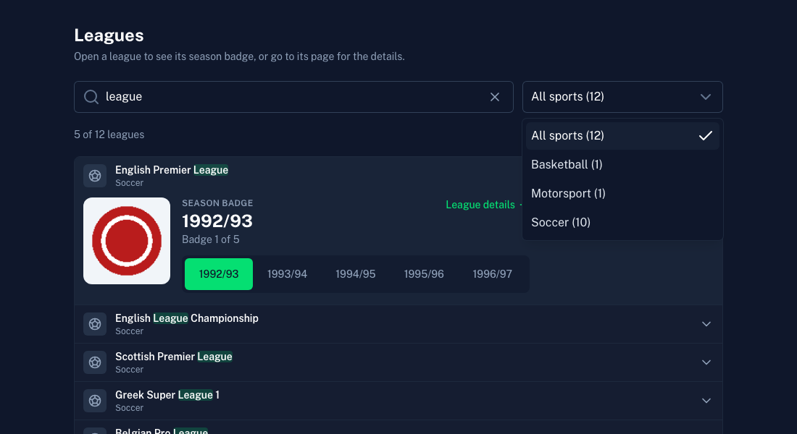

# Sports Leagues

A Nuxt 4 app that lists sports leagues from [TheSportsDB](https://www.thesportsdb.com/): search,
a sport filter, each league's season badges in an accordion, and a server-rendered page per
league. Requests to TheSportsDB go through the app's own server layer, which keeps the API key on
the server and caches the responses.

**Live:** https://sports-league-sooty.vercel.app



The free TheSportsDB key returns only Soccer leagues, so on live data the sport filter is shown
but disabled. To try it with several sports, run the app on the bundled fixtures:

```bash
npm install
npm run dev:fixtures   # http://localhost:3000, mixed sports and edge cases
```

## Features

- **League list**, rendered on the server: name and sport of each league.
- **Search** that ignores case, extra spaces and accents, with the match highlighted.
- **Sport filter** built from the data, with a count per sport.
- **Season badges:** opening a league shows a badge and a season picker (segments up to five
  seasons, a stepper above). A badge is fetched once per league and reused.
- **League page** (`/leagues/<id>`): logo, details, description and every season badge; a 404 page
  for unknown leagues.
- **The URL holds the screen** (`?q=`, `?sport=`, `?open=`, `?season=`): reload, share or go back
  and you get the same view.
- Loading, empty and error states with "Try again"; dark and light themes; keyboard and
  screen-reader friendly; works from 320 px up.

## Tech stack

| Area | Libraries | Used for |
|---|---|---|
| Framework | Nuxt 4 (Vue 3.5, vue-router 5, Nitro) | Server rendering, routing and the app's own `/api` layer |
| UI | Nuxt UI 4 (Reka UI, Tailwind CSS 4) | Accessible components, color tokens, dark mode; brings Nuxt Icon, Nuxt Fonts and Color Mode |
| State | Pinia 4 | Stores over the URL state, the league list and the badge cache |
| Composables | VueUse 15 | `useDebounceFn` (search), `useTimeAgo` (data freshness), `useWindowScroll` (back to top) |
| HTTP | ofetch, h3 | Upstream calls with a timeout; route handlers and HTTP errors |
| Icons | Iconify Lucide and Tabler, installed locally | Icons without runtime API calls |
| Language | TypeScript 6 (strict), vue-tsc | One typecheck for the app, the server, the tests and the configs |
| Unit tests | Vitest 5, @nuxt/test-utils 4, Vue Test Utils, happy-dom, v8 coverage | Server layer, utilities, stores and components |
| E2E | Playwright | User flows on the production build against a fixture server |
| Code quality | ESLint 10 (@nuxt/eslint), husky, lint-staged, commitlint | Lint, git hooks, Conventional Commits |
| CI/CD | GitHub Actions, Vercel | Checks on every pull request; preview and production deploys |

Why these and not the alternatives: [`docs/decisions.md` §2](./docs/decisions.md#2-stack).

## Requirements

Node `^22.22.3 || ^24.15.0` (`.nvmrc`: 24) and npm.

## How to run

```bash
npm install

npm run dev                  # development server on the live API
npm run dev:fixtures         # the same on local fixtures (several sports, edge cases)

npm run build                # production build
npm run preview              # serve the production build

npm run test:run             # unit and component tests (Vitest)
npm run test:coverage        # server and utility tests with coverage thresholds
npx playwright install chromium   # once per machine
npm run build && npm run test:e2e # end-to-end tests on the production build and the fixtures
```

No configuration is needed: the free API key is the default. `.env.example` lists the two optional
server settings (`NUXT_SPORTSDB_API_KEY`, `NUXT_SPORTSDB_BASE_URL`).

## Scripts

| Script | What it does |
|---|---|
| `dev` | Nuxt development server against the live API |
| `dev:fixtures` | Fixture server plus `nuxt dev` pointed at it; Ctrl+C stops both |
| `build` / `preview` | Production build / serve it locally |
| `lint` / `lint:check` | ESLint with fixes / without (CI) |
| `typecheck` | `nuxt typecheck` over the app, the server, the tests and the configs |
| `test` / `test:run` | Vitest in watch mode / once, both projects (`node` and `nuxt`) |
| `test:coverage` | The `node` project with v8 coverage and thresholds |
| `test:smoke` / `test:e2e` | Playwright: the smoke spec / every spec, on an existing build |
| `screenshot` | Regenerates the README image above (not part of CI) |
| `warm` | `npm run warm -- <url>`: warms the cache after a deploy (see CI/CD) |

## How it works

- **Server layer (Nitro).** The browser only talks to the app's `/api` routes:
  `GET /api/leagues`, `/api/leagues/:id/seasons` and `/api/leagues/:id`. One adapter calls
  TheSportsDB with a timeout and no retries, detects its failures (the rate-limit page, non-JSON,
  timeouts) before reading the data, and maps it to our own types. Results are cached on the
  server (league list 30 minutes, details a day, archive seasons a week), errors never; successful
  responses carry `Cache-Control` for the CDN. A league id is checked against the cached list
  before any per-league request.
- **State.** The URL is the storage for the list (search, sport, open league, season); Pinia stores
  read and write it (`router.replace`) and hold the fetched data, including a per-league badge
  cache. Only the search box keeps a local draft, written to the URL with a 250 ms debounce.
- **Rendering.** Pages are server-rendered and hydrate into an SPA; the data loaded on the server
  is reused by the client instead of being fetched again.
- **UI.** Nuxt UI components and tokens, VueUse helpers, locally installed icons and fonts.
- **Tests.** Vitest for the server layer, utilities, stores and components; Playwright for the user
  flows on the production build, with a fixture server instead of the live API.

The reasoning behind these choices is in [`docs/decisions.md`](./docs/decisions.md).

## CI/CD

Every change passes the same gates, locally and on GitHub.

**Locally**, git hooks (husky) run ESLint on the staged files (lint-staged) and the typecheck before
each commit, and commitlint checks that the message follows Conventional Commits.

**GitHub Actions** ([`ci.yml`](./.github/workflows/ci.yml)) runs on every pull request and every
push to `main`, on the Node version from `.nvmrc`. The checks run in parallel, the build waits for
them, and the e2e suite runs on that same build:

```text
Lint ───────┐
Typecheck ──┼──► Build ──► E2E
Unit tests ─┘
Audit
```

| Job | Needs | Steps |
|---|---|---|
| Lint | — | `npm ci` → `lint:check` |
| Typecheck | — | `npm ci` → `typecheck` |
| Unit tests | — | `npm ci` → `test:coverage` (server, shared code, utilities; coverage thresholds) → `vitest run --project nuxt` (stores, components, pages) |
| Audit | — | `npm audit`, reported but not blocking |
| Build | Lint, Typecheck, Unit tests | `npm ci` → `build` → `.output` uploaded as an artifact |
| E2E | Build | `npm ci` → the build artifact → `playwright install --with-deps chromium` → `test:e2e`; the Playwright report is uploaded when it fails |
| Lint, Typecheck, Test, Build | Lint, Typecheck, Unit tests, Build | The gate. It runs nothing itself: one step reads the results of those four jobs and fails if any did not pass. It carries the name of the ruleset's required check |

**`main` is protected** by a ruleset: changes arrive only through a pull request, rebase-merged
(linear history); force-pushes and deletion are blocked; the gate "Lint, Typecheck, Test, Build"
must be green. E2E runs on every pull request but is not required. Work happens on `dev`, one
commit per plan phase.

**Vercel** deploys through its Git integration (Nuxt preset, Node 24, no `vercel.json`, no
environment variables): a preview for every pull request, production for every push to `main`.
After a production deploy, warm the cache once:

```bash
npm run warm -- https://sports-league-sooty.vercel.app
```

It requests the list, then each league's seasons and details, 9 s apart (the free API key blocks
about ten quick requests in a row), so it takes about three minutes. It stops at the first error.

## How it was built

The project went from the assignment to production in stages, each written down in `docs/` before
the next one began:

1. **Requirements.** The assignment kept verbatim, split into R1–R13 plus what is graded (E1), with
   the ambiguous parts interpreted in writing: [`requirements.md`](./docs/requirements.md).
2. **API research.** What the free key really returns, observed before any design: 10 leagues, all
   Soccer; the five oldest seasons; HTTP 200 with an error string for a bad id; a Cloudflare block
   after about ten quick requests: [`api.md`](./docs/api.md).
3. **Idea, stack and architecture.** Nuxt with its own server layer, the URL as state, server-side
   caching, and fourteen recorded decisions: [`decisions.md`](./docs/decisions.md).
4. **Design.** A prototype on real API data, then a spec with tokens, states and accessibility:
   [`design.md`](./docs/design.md), screenshots in [`docs/design/`](./docs/design/).
5. **Plan.** Eight phases; every step names its tests, "Done when", a check and its commit:
   [`plan.md`](./docs/plan.md).
6. **Implementation.** One phase at a time, tests first, a review before every commit. The core
   brief (R1–R8) was complete after Phase 4; polish, the league page and the e2e suite followed.
7. **Repository, CI/CD, deploy.** After Phase 5 `main` went public with CI, Vercel production and a
   ruleset; later phases arrived through pull requests from `dev`, and in Phase 8 CI was split into
   one job per concern.
8. **Verification.** The checks at every step, the plan's manual checks on the production build at
   every phase, the README followed in a fresh clone, CDN cache hits confirmed on production.

**Scope and time.** The brief suggests about 90 minutes; this project goes further on purpose. The
core brief (R1–R8) was complete after Phase 4, and everything after it (polish, the league page,
the e2e suite, the deploy) is an extra that could have been cut.

**AI tools.** Claude Code wrote the docs, the code and the tests with the owner, one plan step at a
time, following `CLAUDE.md` and the `phase` and `review` skills (published in `.claude/`); Claude
Design produced the prototype; independent reviewer agents checked the docs and every phase. The
owner made the decisions, reviewed every phase and did every git, GitHub and Vercel step.

The full story — what each stage decided, what the reviews and tests caught, and how AI tools were
used — is in [`docs/process.md`](./docs/process.md).

## Documentation

[`docs/`](./docs/) holds the assignment and its requirements, the API notes, the decisions, the
design spec with screenshots of the prototype, the phased plan the project was built from, and the
story of how it was built. `CLAUDE.md` and `.claude/skills/` are the instructions the AI assistant
worked with.

Not affiliated with TheSportsDB.
